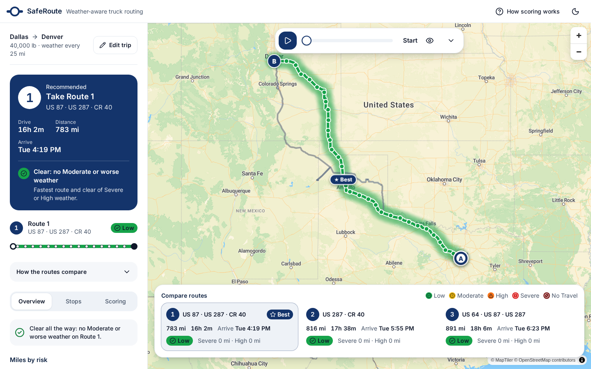
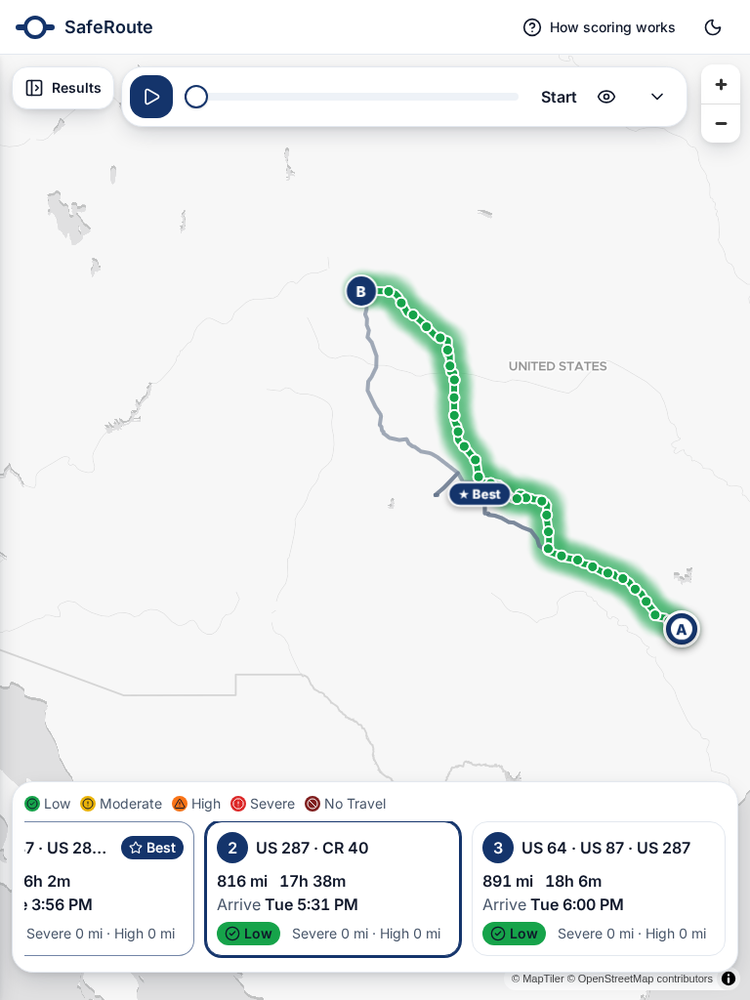
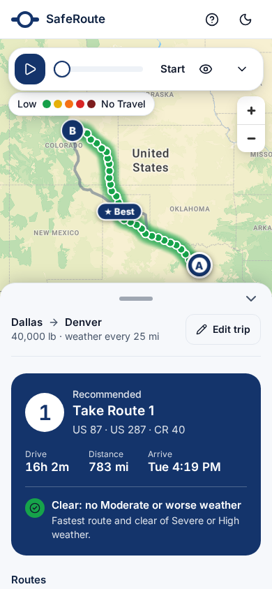

# saferoute-frontend

React + TypeScript + Vite web app for **SafeRoute**, weather-aware truck routing: plan a trip, compare up to three truck routes,
and scrub a 0-48 hour weather heatmap along the selected route. Tailwind v4, shadcn/Base UI, MapLibre GL, MapTiler basemap.

It is a standalone service. All routing, weather and risk logic lives in the API,
[`saferoute-backend`](../saferoute-backend); this app only calls it over HTTP.

| Desktop | Tablet drawer | Phone |
|---|---|---|
|  |  |  |

## Run it locally

Node 20+ and a free [MapTiler](https://cloud.maptiler.com/account/keys/) key.

```bash
npm install
cp .env.example .env      # add VITE_MAPTILER_KEY; VITE_API_BASE_URL defaults to http://localhost:8000
npm run dev               # http://localhost:5173
```

`npm run dev` starts **only** this app. Start the API separately from `saferoute-backend` (`make dev`).
No API yet? Open `http://localhost:5173/?mock` to explore with canned places and a sample plan.

| Variable | Purpose |
|---|---|
| `VITE_API_BASE_URL` | Where the API lives (default `http://localhost:8000`) |
| `VITE_MAPTILER_KEY` | MapTiler basemap and place search (public in the browser: restrict it to your domains) |
| `VITE_MAP_STYLE_LIGHT` / `VITE_MAP_STYLE_DARK` | Optional MapLibre style URL overrides |

Other scripts: `npm test`, `npm run lint`, `npm run build`, `npm run preview`.

## Layout

One codebase, one set of state. [`usePlanner`](src/features/planner/usePlanner.ts) holds all state and actions; three layout
components only decide where things sit:

- **Desktop (>= 1024px):** header, fixed sidebar (320px, 360px from 1440px), map, bottom route-comparison panel.
- **Tablet (768-1023px):** full map with a 340px drawer and a route carousel.
- **Mobile (< 768px):** full-screen map, a three-position bottom sheet, and a checkpoint details sheet.

Design system: [DESIGN.md](DESIGN.md) and [PRODUCT.md](PRODUCT.md). Architecture notes: [docs/ARCHITECTURE.md](docs/ARCHITECTURE.md).

## Extending

- **Another geocoder or basemap:** place search lives in [`src/api/geocode.ts`](src/api/geocode.ts) and the style URLs in [`mapStyle.ts`](src/features/map/mapStyle.ts); they are the only files that know about MapTiler.
- **Change the look of a risk level:** one place, [`src/lib/risk.ts`](src/lib/risk.ts).

## Deploying (Netlify)

Import this repository; [`netlify.toml`](netlify.toml) sets the build command and the SPA redirect.
Set `VITE_API_BASE_URL` (your deployed API) and `VITE_MAPTILER_KEY` in the site's environment variables, and add the site URL to the API's `ALLOWED_ORIGINS`.
